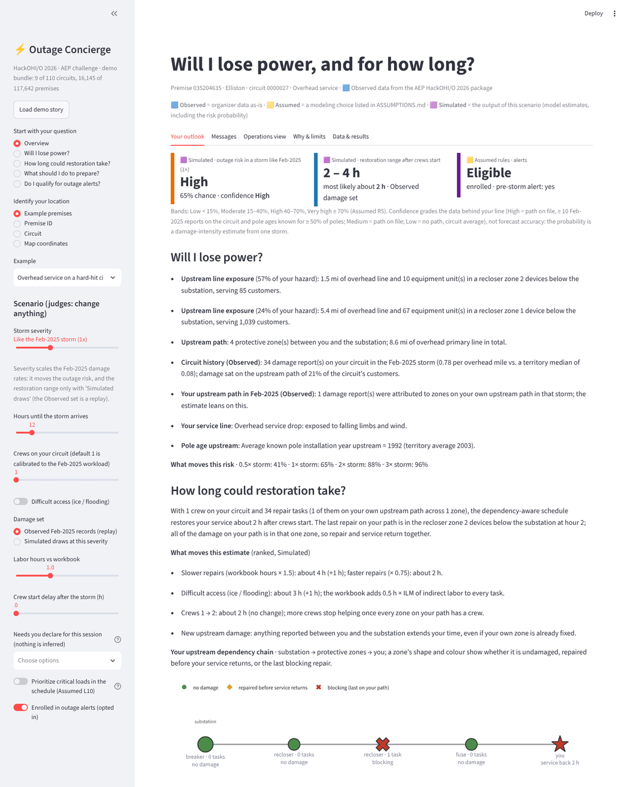
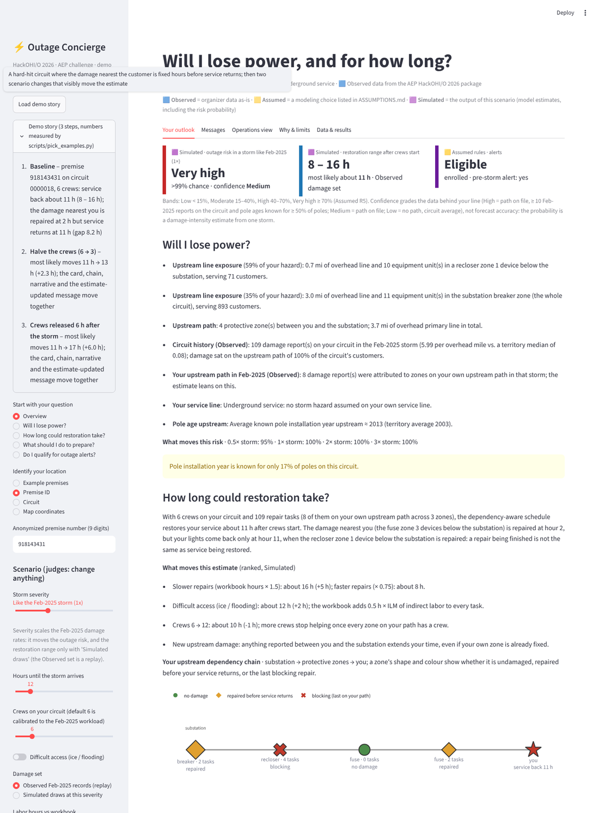
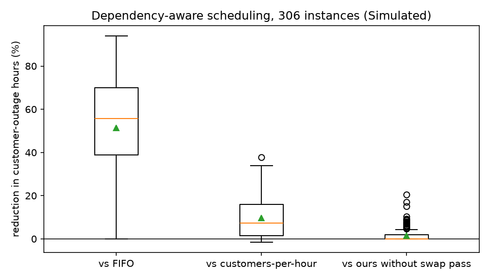

# AEP AI Outage Concierge — HackOHI/O 2026

[](https://github.com/AdhritSingh21/aep-outage-concierge/actions/workflows/ci.yml)
[](LICENSE)

**Live demo:** https://aep-outage-concierge.streamlit.app/ (first load takes about 10 s if the app was asleep) ·
**Diagrams:** [docs/diagrams.md](docs/diagrams.md) ·
**Full write-up:** [docs/details.md](docs/details.md) · **Assumptions:** [ASSUMPTIONS.md](ASSUMPTIONS.md)

For one anonymized premise, one screen answers the brief's four questions: **Will I lose power?** (a risk band with its
confidence and the factors behind it), **How long could restoration take?** (a range from labor hours and crew
scheduling, with *repair completed ≠ service restored* drawn on the customer's own upstream chain), **What should I do
to prepare?** (sourced guidance scaled to risk, duration and declared needs) and **Do I qualify for outage alerts?**
(rules, timing, channels, escalation, four message drafts). Underneath is a **network-aware repair scheduler** that cuts
customer-outage hours against FIFO and a most-customers-first heuristic on identical inputs.

Every number in the app, in this README and in `results/` is tagged **Observed** (organizer data as-is), **Assumed** (a
modeling choice listed in [ASSUMPTIONS.md](ASSUMPTIONS.md)) or **Simulated** (the output of a scenario run); runtimes
are **Measured**. No number was typed by hand: each comes from a file a script in `scripts/` produced.



## The demo in 3 clicks

Numbers from `data/demo/examples.json`, written by `scripts/pick_examples.py` (Simulated on Observed data).

1. **Load demo story.** Premise 918143431 on circuit 0000018, the Observed Feb-2025 damage set, 6 crews: service back in
   about 11 h (8–16 h). The dependency chain shows the damage nearest the customer repaired at hour 2 while service
   returns at hour 11, because a recloser zone upstream is still being repaired.
2. **Halve the crews (6 → 3).** 11 h → 13 h; the card, the chain, the narrative and the estimate-updated message move
   together, because all of them are pure functions of one `Scenario`.
3. **Release crews 6 h after the storm.** 11 h → 17 h; the delay is counted once in every time shown, and the message
   names it as the reason.

Also in the sidebar: an opening example whose band moves 41% → 65% → 88% → 96% across the four storm severities, a
declared life-support account (voice channel and wellness-check escalation without touching a toggle), and a premise
with no upstream path on file, which is told "being assessed" instead of a number.



## What the brief asked for, and where it is

| Brief requirement | Where in the app |
|---|---|
| Accept a premise, circuit or map location | sidebar: script-chosen example premises, anonymized premise id, every premise of a circuit, coordinates → nearest premise with an out-of-area warning |
| Risk band with contributing factors and uncertainty | *Your outlook*: band, probability, confidence with its definition, factors with hazard shares, risk at every severity (`concierge/risk.py`) |
| Restoration range that reacts to damage, upstream dependencies, labor, crews, access | range + narrative + ranked "what moves this estimate" + dependency chain + zone map (`labor.py`, `scheduling.py`, `restoration.py`); the Operations view shows the circuit coming back zone by zone |
| Model output vs confirmed information | Observed / Assumed / Simulated tags on every card, message part and evidence row; scenario inputs never appear under "what we know" |
| Guidance by risk, duration and declared needs | *What should I do to prepare?*: sourced items; medical, mobility and facility needs are declared for the session, never inferred (`guidance.py`) |
| Alert eligibility, timing, channel, escalation; four messages | rules E1–E8, eligibility kept separate from enrollment, every escalation trigger shown with its state, drafts marked would / would not be sent, rule E5 dead-band (`alerts.py`, `messages.py`) |
| Explainability, assumptions, missing data, privacy, fallback | *Why & limits*: observed facts, model output, assumptions in play, validation numbers from `results/*.json`, what changed after testing, downloadable audit log; "being assessed" when the fallback is in use |
| Priority locations | life-support accounts (Observed flags) and critical facilities as counts per zone, reported in every schedule and weightable in the ordering (`priority.py`) |
| Judges can change an input | severity, hours to the storm, crews, access, damage set, labor factor, crew start delay, declared needs, critical-load priority, enrollment |

## Results (Simulated; `scripts/run_benchmark.py`, tables in `results/benchmark_summary.md`)

306 instances = 46 circuits with ≥ 3 Feb-2025 damage records × {Observed Feb-2025 set, 2 seeded simulated sets} × that
circuit's distinct crew counts from {1, calibrated default, 2× default}. Reduction = 1 − ours ÷ baseline in
customer-outage hours.

| baseline | mean reduction | median | win rate | worst instance |
|---|---|---|---|---|
| FIFO (report order) | 51.5% | 55.8% | 100% | 0.0% |
| customers-per-hour heuristic | 9.6% | 7.3% | 99% | −1.6% |
| ours without the swap pass | 1.4% | 0.0% | 100% | 0.0% |

At every circuit's own calibrated crew count the gain over the heuristic is 8.6%; on the 10 circuits with more than one
crew, 17.5%. The heuristic beat us on 3 of 306 instances, by at most 1.6% (listed in the summary). On the 64 instances
small enough for brute force, 60 are at the optimum; the largest gap is 9.2%. Risk model: leave-one-circuit-out
Spearman 0.658 for the feature model vs 0.644 for overhead miles alone (`results/risk_validation.md`), so the zone's own
Feb-2025 count carries the estimate and the app says so.



## How it works

- **Data (Observed).** A stdlib shapefile reader (`concierge/shapefile_io.py`) loads the 12 GIS layers; `etl.py`
  writes typed parquet and `data/data_report.md`. Every layer is remapped to the transformer layer's (station, circuit)
  key because the anonymized `circuit_id` disagrees between layers for ~14 circuits.
- **Topology.** Each protective device in a path is a *zone*; 7,190 zones form one tree per circuit and every premise
  sits in exactly one leaf zone, so nothing is double-counted. Critical facilities are kept as counts per zone.
- **Risk.** A Poisson regression of Feb-2025 damage counts per circuit with overhead miles as exposure gives a prior
  rate; each zone's rate is the gamma-Poisson posterior that also uses its own count (empirical Bayes).
  P(outage | severity s) = 1 − exp(−s·Σ zone rates on the path). Confidence grades data coverage, not forecast accuracy.
- **Labor.** Workbook CU averages combined into damage-type bundles (pole ≈ 34 person-hours with ILM 4.5, primary wire
  ≈ 3.4, fuse bank ≈ 3.7, transformer ≈ 17.4); the indirect-labor multiplier is applied exactly once; a 4-person crew
  works a task in parallel.
- **Scheduling.** K identical crews; a customer is restored only when every damaged zone on their path is repaired.
  Policies on identical inputs: FIFO, customers-per-hour, and ours: Horn's 1972 tree-merge order on the damaged-zone
  tree (optimal for one crew), list-scheduled on K crews, plus an adjacent-swap pass capped at 1,500 evaluations so the
  schedule does not depend on the machine. Solver status is shown in the app.
- **Time and states.** Schedules are solved from hour 0 and the crew start delay is added once, at display time.
  A premise is *affected* (a range), *not affected by this damage set* (simulated draws give "affected in P% of draws")
  or *unknown* (no path on file: "being assessed", never a number).

Full methods, the questions we asked of the data, the architecture diagram and the scaling probe are in
[docs/details.md](docs/details.md).

## What broke and what we changed

| What we tried | What we observed | What we changed to |
|---|---|---|
| Join recloser path tokens by id | 0% of 322 tokens matched | match by location (100%); fuses by id |
| Trust the numeric circuit id across layers | disagrees for ~14 circuits; `NEAR_FID` was computed on unclipped layers | transformer-layer (station, circuit) key with nearest-line fallback; 0 unresolved |
| Circuit-feature regression for risk | leave-one-out Spearman 0.658 vs 0.644 exposure-only | exposure as the backbone; the zone's own count carries the estimate; say so on screen |
| "Most customers first" ordering | restores a 1 h fuse before the 2 h recloser 160 customers depend on | Horn tree-merge + swap pass; 9.6% mean gain, 3 losses listed |
| Crew start delay in the schedule and at display | every time shown was wrong by the delay; the > 24 h escalation mis-fired | solve from hour 0, add the delay once, unit test |
| One message template for every state | "restoration would likely take no interruption is expected" | explicit restoration states and a secondary simulated range |
| Widget defaults from the first premise | the life-support example showed no medical handling | per-premise session resets, declared-needs list, Streamlit AppTest |

The full audit (swap-pass time box, benchmark bookkeeping, facilities, placeholder repair dates) is in
[docs/details.md](docs/details.md#what-broke-and-what-we-changed) and in `PLAN.md`, milestone M8.

## Limits and responsible use

- One reference storm: the probability is a damage-intensity estimate, not a forecast, and confidence grades data
  coverage. No per-customer outage records exist; repair dates are day-granularity and never used as durations.
- Tie switches and back-feeds are not modeled; travel enters only through the workbook multiplier. 47 premises
  (3 in the demo bundle) have no upstream path and use the fallback.
- Privacy: no address, road, meter or annotation field is ever loaded; premises are anonymized ids; the public bundle
  rounds coordinates to about 100 m and keeps facilities as counts; the map draws zone centroids, never premises.
- Three labels on every number, assumptions never presented as facts in messages, rule E5 stops noise updates,
  safety items first and sourced, and a downloadable audit log of every scenario run.
- Scale (Measured, `results/scale_probe.md`): Horn's ordering costs 0.78 ms at 209 tasks and 1.24 ms at 2,090; the
  swap pass is the quadratic part, so a territory-scale deployment shows the Horn order with a truncated pass, which is
  what the cap does today. Scheduling is per circuit, so a 10× territory is 10× independent journeys, not one 10× slower.

## Run it

```bash
git clone https://github.com/AdhritSingh21/aep-outage-concierge
cd aep-outage-concierge
python -m venv .venv
.venv\Scripts\activate            # Windows   (source .venv/bin/activate on macOS/Linux)
pip install -r requirements.txt
streamlit run app.py               # runs on the committed demo bundle in data/demo (9 circuits, 16,145 premises)
python -m pytest -q                # unit tests + demo-bundle tests; tests marked `data` need data/processed
```

Full organizer dataset (optional, ~450 MB extracted): download the package from
https://github.com/hackohio/aep_challenge_hack26 and run

```bash
python scripts/prepare_data.py --source "path/to/aep_challenge_hack26-main.zip"
python scripts/pick_examples.py            # example premises and the demo story, chosen by criteria
python scripts/run_benchmark.py            # about 30 s; regenerates results/benchmark.*
python scripts/scale_probe.py --date YYYY-MM-DD   # measured runtimes, results/scale_probe.md
```

The public demo redeploys from `main` on Streamlit Community Cloud; CI runs the test suite and starts the app headless
on every push. Hosting notes are in [docs/details.md](docs/details.md#hosting-a-demo-link).

## Repository

```
app.py                 Streamlit UI (sidebar Scenario → tabs Your outlook, Messages, Operations view, Why & limits, Data & results)
concierge/             shapefile_io, etl, topology, exposure, priority, risk, labor, scenario, scenarios, scheduling,
                       restoration, alerts, guidance, messages, evidence, viz, journey, data, config
scripts/               prepare_data.py (organizer zip → processed tables, model, demo bundle), run_benchmark.py,
                       pick_examples.py, scale_probe.py, slim_demo_bundle.py, map_demo_facilities.py
tests/                 unit tests (synthetic), demo-bundle tests (always run), data tests (skipped without data/processed)
data/                  README.md (how to obtain the data, attribution); demo/ committed; raw/extracted/processed ignored
results/               risk_model.json, risk_validation.md, benchmark.csv, benchmark_summary.md, benchmark_headline.json,
                       benchmark.png, scale_probe.md
docs/                  details.md (full write-up), diagrams.md (Mermaid), pitch.md (interview one-pager), img/ (screenshots)
ASSUMPTIONS.md  PLAN.md  CONTRIBUTING.md
```

## Sources

<details>
<summary>Publications and guidance pages cited in the app and in this README</summary>

- AEP Ohio, "Outages FAQ," aepohio.com/outages/faq; AEP Ohio, *What To Do When The Lights Go Out* (PDF), aepohio.com;
  AEP Ohio, "Power Line Safety," aepohio.com/safety/power-lines.
- New Jersey Board of Public Utilities, *2020 Tropical Storm Isaias BPU Staff Report*, Board Order 6A, Nov. 18, 2020.
- Michigan Public Service Commission, news release, July 16, 2026, Case No. U-22156.
- NYSEG / RG&E, "NYSEG and RG&E Improve Restoration Time Accuracy," nyseg.com.
- J.D. Power, *2025 U.S. Electric Utility Residential Customer Satisfaction Study* (press release); *Utilities Outlook 2026*.
- EEI / U.S. DOE, *Restoring Power After a Storm: A Step-by-Step Process* (PDF); Ohio Adm. Code 4901:1-10-08 (2024).
- U.S. DOE, *Fault Location, Isolation, and Service Restoration Technologies Reduce Outage Impact and Duration* (2014).
- Horn, W. A. (1972). Single-machine job sequencing with treelike precedence ordering and linear delay penalties.
  *SIAM Journal on Applied Mathematics*, 23(2), 189–202. doi:10.1137/0123021.
- Efron, B., & Hastie, T. (2016). *Computer Age Statistical Inference*, ch. 6 (empirical Bayes). Cambridge University Press.
  Hilbe, J. M. (2011). *Negative Binomial Regression* (2nd ed.). Clayton, D., & Kaldor, J. (1987). *Biometrics*, 43(3), 671–681.
- Safety guidance: ESFI, "Downed Power Line Safety"; Puget Sound Energy, "Downed power lines"; ESA Ontario, "Powerline
  Safety at Home"; CDC, "What to Do to Protect Yourself During a Power Outage" and the carbon-monoxide PSA toolkit;
  FoodSafety.gov, "Food Safety During Power Outage"; USDA FSIS, "Keeping Food Safe During an Emergency"; FDA, "Food and
  Water Safety During Power Outages and Floods"; Ready.gov (FEMA), "Water"; American Red Cross, "Power Outage Safety"
  and the *Power Outage Preparedness Checklist*; NOAA National Weather Service, "Flood Safety for You and Your Family".
  (Each guidance item in the app names its source; the figures are theirs, the wording is ours; C4.)
- Sources were located through publisher-site search on 2026-10-25; spot-check a URL before quoting it in print.

</details>

## Data, attribution and license

Organizer data is provided by **AEP** for **HackOHI/O 2026**: https://github.com/hackohio/aep_challenge_hack26. It is
not redistributed here except for the small derived demo bundle in `data/demo/` (9 circuits, anonymized premise ids
only, coordinates rounded, no customer or structure identifiers, facilities as counts); see
[data/README.md](data/README.md). Code is MIT (see [LICENSE](LICENSE)); the challenge data is not covered by this
license and remains the property of AEP / HackOHI/O.
