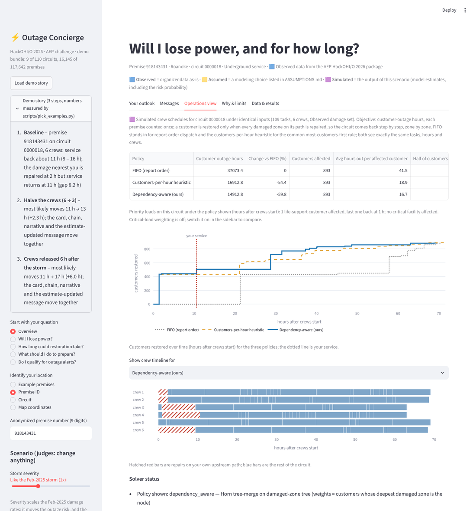
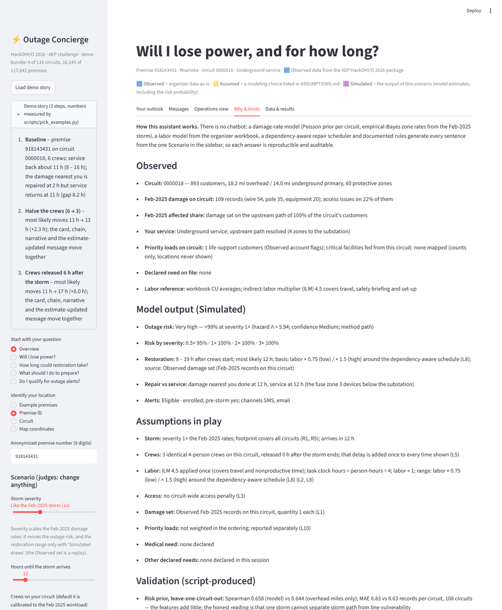
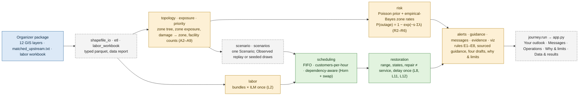

# Full write-up: background, methods, results, what broke, scaling, impact

The long form of the project, moved out of the README on 2026-10-25 so that the README reads in one screen. Labels are the same everywhere: **Observed** (organizer data as-is), **Assumed** (a modeling choice listed in [ASSUMPTIONS.md](../ASSUMPTIONS.md)), **Simulated** (the output of a scenario run), **Measured** (a wall-clock runtime). Every number comes from a file a script in `scripts/` produced. Sources are listed in the README.

## What utilities do today, and what we changed

**Today.** When an outage is reported, the published estimated restoration time (ETR) is an area-level average that is
revised once a crew has assessed the damage, and utilities say premise-level prediction is hard (AEP Ohio, *Outages
FAQ*). Automated ETR messages that default to a global estimate have produced "multiple inaccurate" updates and
customer confusion, and regulators have ordered ETR-accuracy plans (New Jersey BPU, *2020 Tropical Storm Isaias Staff
Report*; Michigan PSC, July 2026, Case U-22156). Restoration is sequenced by hazards first, then hospitals and
emergency facilities, then the lines that return the most customers (AEP Ohio, *What To Do When The Lights Go Out*;
EEI/DOE, *Restoring Power After a Storm*; Ohio Adm. Code 4901:1-10-08 requires hospitals to be prioritized).
Customers who are told what is happening are measurably more satisfied (J.D. Power, *Utilities Outlook 2026*).

**Strengths of current practice** we kept: a single clear number is easy to communicate; critical facilities first is
the right ladder; report order is transparent and fair. **Weaknesses** we built against: a point ETR carries false
precision; an area ETR says nothing about *your* line; "most customers first" ignores that a downstream repair restores
nobody while an upstream zone is still damaged; updates fire on noise.

**What we changed.** A premise-level **range** with the factors that move it; the customer's own **upstream chain**
with *repair completed ≠ service restored* drawn on it; messages that state assumptions as assumptions and update only
when rule E5's threshold is crossed; and a **dependency-aware ordering** (Horn's 1972 tree-merge on the damaged-zone
tree, list-scheduled on K crews with a swap pass) tested against the two accepted baselines on identical inputs. We also
tested the obvious alternative for risk (a circuit-feature regression) and report that it adds little over exposure.

## Questions we asked, and what we found

- *Does finishing the repair nearest me restore me?* No. Service returns when the last damaged zone on the path is
  repaired; in the demo the nearest damage is fixed at hour 2 and the lights come back at hour 11 (`restoration.py`,
  the chain figure).
- *Is "most customers first" good enough?* No. It ignores the AND-coupling of zones: the toy case in
  `tests/test_scheduling.py` and the 306-instance benchmark (9.6% fewer customer-outage hours on average, 3 losses).
- *Do circuit features predict damage beyond overhead miles?* Barely: leave-one-circuit-out Spearman 0.658 vs 0.644
  for exposure alone, MAE slightly worse (`results/risk_validation.md`), so the zone's own Feb-2025 count carries the
  estimate and the app says so.
- *What in this data could fool us?* `matched_upstream.txt` keys on `premise_nu` (117,595 of 117,642 pathed); recloser
  tokens match the recloser layer by id for 0% of tokens and by location for 100%; `report_len` is feet (ratio to
  geodesic length 0.997); 14 circuits carry a different `circuit_id` between GIS layers; 24 repair dates are a
  placeholder; repair dates are day-granularity and never used as durations (`data/data_report.md`).
- *How do we avoid double counting?* ILM is applied once and already covers travel and set-up; every premise sits in
  exactly one leaf zone; the crew start delay is added once, at display time (a test enforces it).
- *How does a customer tell a fact from our guess?* Three labels on everything, and "being assessed" instead of a
  number when the fallback is in use.
- *Who else matters on a circuit?* 113 life-support accounts territory-wide (Observed flags) and the hospitals, fire
  stations and ambulance services the USGS layers place near a line; counted per zone, never located.
- *What did the first judging-readiness audit find?* See *What broke and what we changed*.

## Methods

**Data (Observed).** The stdlib shapefile reader in `concierge/shapefile_io.py` loads the 12 GIS layers; `etl.py`
writes typed parquet tables. Verified facts that shape the design are listed in `data/data_report.md` and summarized
above. The anonymized `circuit_id` differs between GIS layers for ~14 circuits, so every layer is remapped to the
transformer layer's unambiguous (station, circuit label) key; the damage file's `NEAR_FID` was computed on unclipped
layers and is ignored.

**Topology.** Each protective device in a path (fuse, recloser, sectionalizer, breaker) is a *zone*; 7,190 zones form
one tree per circuit. Primary segments are assigned to zones by cutting the structure graph at device locations and
voting with the transformers inside each piece; damage records are attributed by key and nearest line. Every premise
belongs to exactly one leaf zone, so nothing is double-counted. Critical facilities are mapped to the zone of the
nearest primary segment within 2 km and kept as counts (`priority.py`, A9).

**Risk.** A Poisson regression of Feb-2025 line-damage counts per circuit with overhead miles as exposure gives a prior
rate; each zone's rate is the gamma-Poisson posterior that also uses the zone's own Feb-2025 count (negative-binomial
dispersion by maximum likelihood; parametric empirical Bayes in the sense of Efron & Hastie 2016, ch. 6). A customer is
interrupted by damage anywhere on their upstream path, so P(outage | severity s) = 1 − exp(−s·Σ zone rates on the
path). The band is decided on the rounded percent; confidence grades data coverage, not forecast accuracy, and the app
says so under the card. One storm cannot separate storm path from vulnerability; the probability is a damage-intensity
estimate, not a forecast.

**Labor.** Workbook CU averages are combined into damage-type bundles (pole ≈ 34 person-hours with ILM 4.5, primary
wire ≈ 3.4, fuse bank ≈ 3.7, transformer ≈ 17.4), adders follow the workbook, the indirect-labor multiplier is applied
exactly once (it is the organizer's travel and nonproductive-time factor), and a 4-person crew works a task in parallel.

**Scheduling.** Tasks sit in zones; K identical crews; a customer group is restored only when every damaged zone on its
path is repaired, so the circuit comes back step by step. Objective: customer-outage hours. Policies on identical
inputs: FIFO (report order), customers-per-hour (customers downstream ÷ hours, ignoring the AND-coupling), and ours:
Horn's tree-merge ordering on the damaged-zone tree with weights = customers whose deepest damaged zone is the node
(optimal for one crew with upstream-first precedence), list-scheduled on K crews, plus an adjacent-swap improvement pass
on the exact objective, capped at 1,500 evaluations in the app so the schedule does not depend on the machine (L9).
"Prioritize critical loads" adds 200 customers-equivalent per life-support customer or facility to the weights (L10);
it is off by default and in every benchmark. Solver status (order source, improvement gain, brute-force gap on ≤ 7-task
instances, runtime, cap) is shown in the app.

**Time convention.** Schedules are solved with crews starting at hour 0; the scenario's crew start delay is added once,
at display time, and every card, chain, message, alert threshold and the Operations view use the same total (L11).

**Restoration states.** *Affected*: a range from the schedule. *Not affected by this damage set*: the Feb-2025 replay
missed the path, so the app also runs the seeded simulated draws and shows "affected in P% of draws; when affected,
X–Y h" (L12). *Unknown*: no upstream path on file, shown as "being assessed" and never sent as a number (E6).

## Results (Simulated, from `scripts/run_benchmark.py`; full tables in `results/benchmark_summary.md`, machine-readable in `results/benchmark_headline.json`)

306 instances = 46 circuits with ≥ 3 Feb-2025 damage records × {Observed Feb-2025 set, 2 seeded simulated sets} ×
that circuit's distinct crew counts from {1, calibrated default, 2× default} (36 circuits have two distinct counts
because their calibrated default is one crew, 10 have three). Reduction = 1 − ours ÷ baseline in customer-outage hours.

| baseline | mean reduction | median | win rate | worst instance |
|---|---|---|---|---|
| FIFO (report order) | 51.5% | 55.8% | 100% | 0.0% |
| customers-per-hour heuristic | 9.6% | 7.3% | 99% | −1.6% |
| ours without the swap pass | 1.4% | 0.0% | 100% | 0.0% |

At every circuit's own calibrated crew count the gain over the heuristic is 8.6% (46 circuits); on the 10 circuits
whose calibrated default exceeds one crew it is 17.5%. On the Observed Feb-2025 sets alone: 40.0% vs FIFO, 10.0% vs
the heuristic. The heuristic beat us on 3 of 306 instances, by at most 1.6% (listed in the summary). On the 64
instances small enough for brute force, 60 are at the optimum; the largest gap is 9.2%. With the calibrated crews the
Observed Feb-2025 sets restore the last customer after a median of 1.5 days across all 46 circuits (2.7 days on the 10
multi-crew circuits); the organizer's day-granularity repair records show report→repair gaps of 0–6 days for 99.6% of
the 478 repaired reference-storm records in the committed bundle (computed by the script; re-run on the full extract
to update). The crew default was calibrated to a 72 h FIFO makespan, so this agreement is partly by construction: a
scale check, not a validation.

## What broke and what we changed

| What we tried | What we observed | What we changed to | Evidence |
|---|---|---|---|
| Join recloser path tokens to the recloser layer by id | 0% of 322 tokens matched | match by location (100%); fuses by id | `data/data_report.md` |
| Join damage by the numeric circuit id | the anonymized id disagrees between layers for ~14 circuits | transformer-layer (station, circuit) key with nearest-line fallback; 0 unresolved keys | `data/data_report.md`, A3, A5 |
| Trust `NEAR_FID` / repair dates | computed on unclipped layers / day-granularity with 24 placeholders | nearest-line attribution; repair dates never used as durations | A5, L7 |
| Circuit-feature regression for risk | leave-one-out Spearman 0.658 vs 0.644 exposure-only | keep exposure as the backbone; the zone's own count carries the estimate; say so on screen | `results/risk_validation.md` |
| "Most customers first" ordering | restores a 1 h fuse before the 2 h recloser 160 customers depend on | Horn tree-merge + swap pass; 9.6% mean gain, 3 losses listed | `tests/test_scheduling.py`, `results/benchmark_summary.md` |
| Time-boxed swap pass | 1.4% mean gain, results differ by machine | kept for its 20% tail, capped at 1,500 evaluations in the app | `results/scale_probe.md`, L9 |
| Crew start delay in the schedule and at display | every time shown was wrong by the delay; the >24 h escalation mis-fired | solve from hour 0, add the delay once, unit test | `tests/test_demo_journeys.py`, L11 |
| One message template for every state | "restoration would likely take no interruption is expected" for 4 of 5 examples | explicit states and a secondary simulated range | `concierge/restoration.py`, L12 |
| Widget defaults from the first premise | the life-support example showed no medical handling; a 1-crew circuit ran with 10 crews | per-premise session resets, declared-needs list, AppTest | `tests/test_app_state.py` |
| Benchmark "default" bucket | counted only the 10 multi-crew circuits (17.5%) | report every circuit's default (8.6%) and the subset; compute the repair-gap sentence | `results/benchmark_headline.json` |
| Facilities loaded, unused | the brief's priority locations were missing | counts per zone, critical-load weighting, facility restoration time | `concierge/priority.py`, A9, L10 |

## Scaling to 10x (Measured, `results/scale_probe.md`)

Horn's ordering costs 0.78 ms at 209 tasks and 1.24 ms at 2,090; the exact objective evaluation grows from 0.83 ms to
4.14 ms, so the adjacent-swap pass is the quadratic part: at 209 tasks the app's swap pass stops at its 1 s ceiling
(1,204 of the 1,500 capped evaluations on the probe machine, so that circuit's displayed schedule is machine-dependent
there, which the probe reports) and converges in 8.7 s (11,648 evaluations, 2.2% gain over Horn's order); at 2,090
tasks one pass alone is a projected 8.7 s, so a territory-scale deployment shows the Horn order with a truncated pass,
which is what the cap and the ceiling do today. Simulated mode is 20 Horn-only solves plus one capped solve: 2.6 s at 1× and 4.6 s at 3× on the largest demo
circuit. Scheduling is per circuit, so a 10× territory is 10× as many independent journeys, not one journey 10× as
slow; the real modeling changes are a shared crew pool across circuits and tie switches (back-feeds break the out-tree
assumption Horn's optimality rests on). More storms, not more features, are the statistical unlock for the risk model.

## Impact: who it helps, and how far it reaches

- **Residential customers** get a premise-level band, a range with its drivers and plain-language messages that say what
  is known, what is estimated and what to do; 117,642 premises on 110 circuits in the organizer extract (Observed).
- **Declared life-support, mobility and critical-facility customers** get the voice channel, earlier notice, wellness
  or transport escalations and facility wording; 113 life-support accounts territory-wide (Observed flags).
- **Dispatch** gets a schedule that cuts customer-outage hours against the two accepted orderings on identical inputs,
  with the life-support and facility restoration times reported beside it.
- **Adoption path.** Replace the Feb-2025 damage set with the live ARCOS/OMS feed and the crew slider with STORMS crew
  counts; the `Scenario` object is the only input. No GPU, no LLM, no secrets; about 1 s per scenario.
- **Long term.** Every additional storm recalibrates the Poisson prior and the zone rates; the labels and the audit log
  make each answer reproducible.
- **Feedback from the target audience:** none yet. The first test we would run is a 15-minute comprehension check of
  the four messages with people outside the team, recorded here with its sample size.

## Responsible use

Three labels on every number; confidence defined where it is shown; "being assessed" instead of a figure when the
fallback is in use; assumptions never presented as facts in messages; rule E5 stops noise updates; safety items first
and sourced; no address, road, meter or annotation field is ever loaded; the public demo bundle carries no customer or
structure identifiers, coordinates rounded to about 100 m and facilities as counts only; the map draws zone centroids,
never premises; a downloadable audit log of every scenario run. Limitations: one reference storm; no per-customer
outage records; tie switches and back-feeds not modeled; no site-to-site travel model (travel enters only through the
workbook multiplier); 47 premises (3 in the demo bundle) have no upstream path and use the fallback.

## How it is built

The architecture, the customer journey with the alert schedule and the development timeline are drawn in
[docs/diagrams.md](diagrams.md) (Mermaid, rendered by GitHub). The architecture in one picture:

Tests (`python -m pytest -q`): scheduling (feasibility, AND semantics, no double counting, toy optimality, brute-force
parity, determinism), labor (ILM once, adders), risk (monotonicity, bands), alerts / guidance / messages (rules, needs,
dead-band, fallback wording), demo-bundle journeys (delay once, states, band/percent agreement, crash guard, demo-story
numbers, priority weighting, facilities as counts), bundle privacy and schema, Streamlit session-state resets
(`streamlit.testing`), topology and zones on synthetic trees; data-marked tests run only with the full extract.

## Hosting a demo link

The public demo is deployed at https://aep-outage-concierge.streamlit.app/ from this repository's `main` branch; a
push to `main` redeploys it. The app runs from the committed `data/demo` bundle, so it can be deployed as-is to
Streamlit Community Cloud: sign in at https://share.streamlit.io with the GitHub account that owns this (public)
repository, choose `AdhritSingh21/aep-outage-concierge`, branch `main`, main file `app.py`, and deploy. No secrets or
environment variables are needed; `requirements.txt` pins the Streamlit version the app was tested with. Locally,
`streamlit run app.py` serves the same demo at http://localhost:8501. The map tab needs internet access in the browser
for OpenStreetMap tiles.
