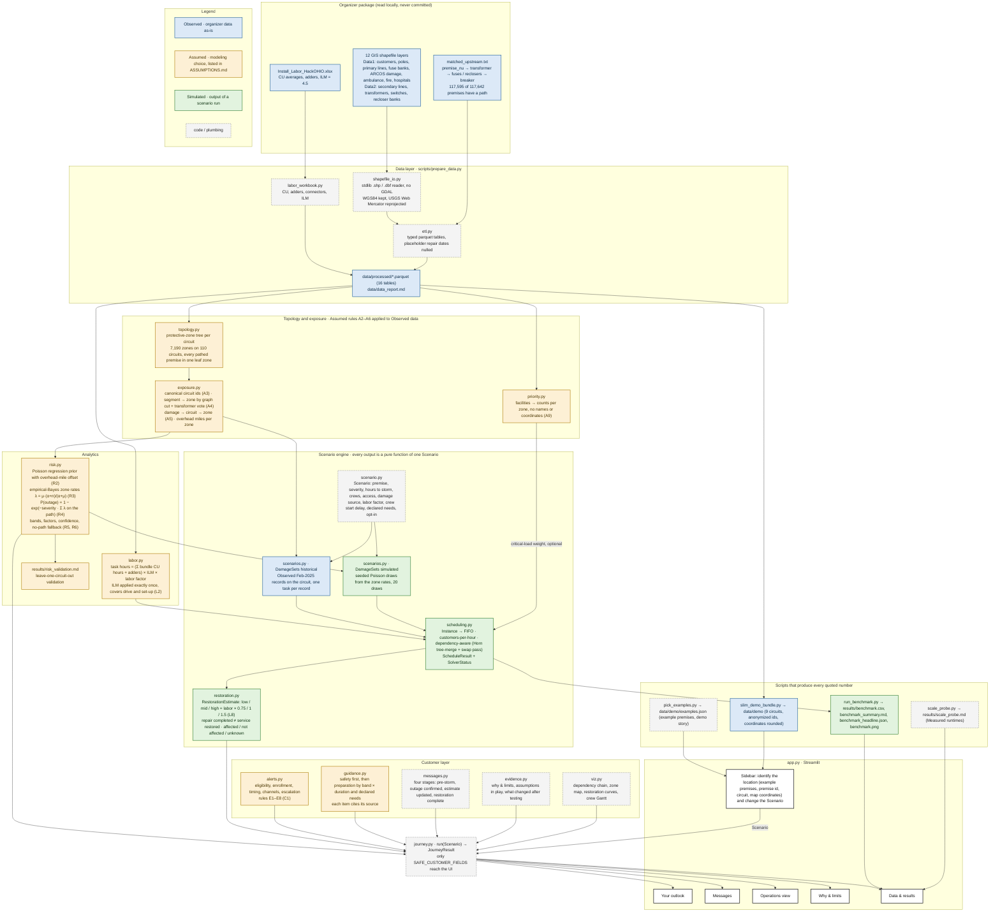
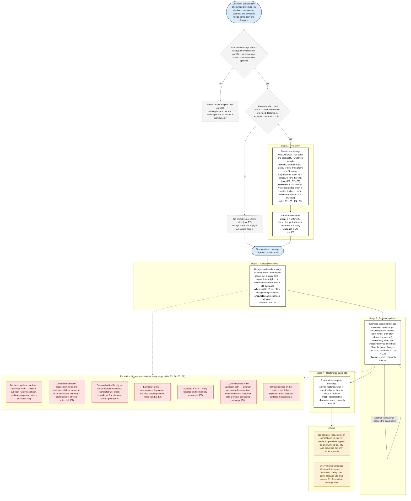
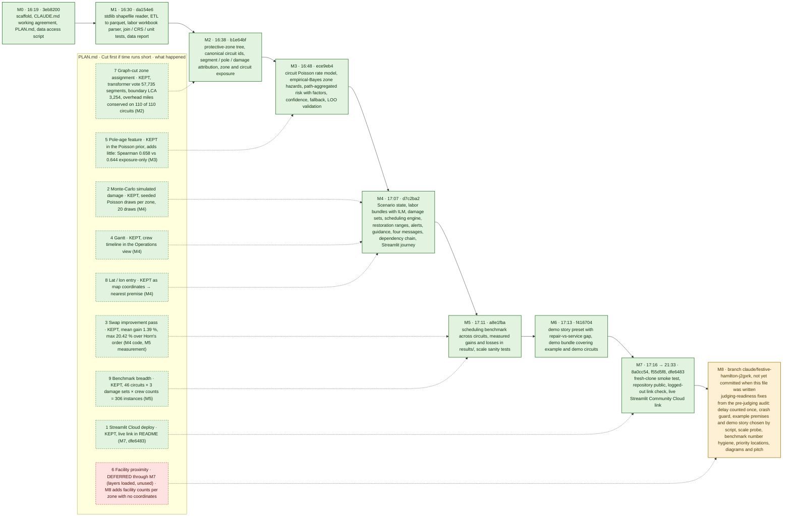

# Diagrams

Three Mermaid diagrams that GitHub renders inline: the architecture and data flow, the customer journey with the
alert schedule, and the development process. Colours follow the project's three labels: **Observed** (organizer data
as-is, blue), **Assumed** (a modeling choice listed in [ASSUMPTIONS.md](../ASSUMPTIONS.md), amber) and **Simulated**
(the output of a scenario run, green). Grey dashed boxes are code or plumbing that carries no number of its own.

Every figure quoted in a node is copied from a file a script produced (`data/data_report.md`,
`results/benchmark_summary.md`, `results/scale_probe.md`, `data/demo/examples.json`) or from `git log`; the sources
are listed under each diagram. Rule ids E1–E8 are the alert rules in `concierge/alerts.py`.

## (a) Architecture and data flow



Sources for the figures in the nodes: 117,595 of 117,642 premises with a path, 7,190 zones, 110 circuits
(`data/data_report.md`, "Join and unit checks" and "Tables"); ILM = 4.5 (`concierge/config.py`, from the workbook);
20 simulated draws (`results/scale_probe.md`, rows 13–14); 16 processed tables (`data/data_report.md`, "Tables");
9 demo circuits (`data/demo/README.md`). Rule and assumption ids refer to `ASSUMPTIONS.md` and `concierge/alerts.py`.

## (b) Customer journey and alert schedule

Timing, channels and escalation triggers are quoted from `concierge/alerts.py` (`RULES`, `decide()`); the
estimate-updated dead-band is `UPDATE_THRESHOLD_H = 2.0` in `concierge/messages.py`. All of them are **Assumed**
rules (C1), not AEP policy.



Where each statement comes from: enrollment vs eligibility (`alerts.py` module docstring and `AlertDecision.status_text`);
E1–E8 (`alerts.py`, `RULES`); the 24 h / 48 h / now and 6 h reminder timing, "within 15 min", "midpoint moves > 2 h or
the band changes" and "at restoration" (`alerts.py`, `decide()`, the `schedule` list); the seven escalation rows
(`alerts.py`, `decide()`, the `escalations` list); the four message stages (`messages.py`, `STAGES`); privacy
(`concierge/config.py`, `PII_FIELDS`; `journey.py`, `SAFE_CUSTOMER_FIELDS`); safety sources (`guidance.py`, `SOURCE_LABELS`).

## (c) Development process

Milestones M0–M8 follow `PLAN.md`. Each box carries the short hash and the commit time from
`git log --format='%h %ad %s' --date=iso` (2026-10-24, UTC−4; the full output is in the table below). A commit time is
when a milestone was committed, not when work on it started; M0 through the first M7 commit all landed inside one hour
(16:19–17:16) and the last M7 commit (the live link) at 21:33, so the order is real but the spacing is not effort. The lower row is the "Cut first if time runs short" list from `PLAN.md` with what
actually happened to each item, linked to the milestone commit that contains it (found with `git log -S<symbol>`).



`git log --format='%h %ad %s' --date=iso` on this branch (verbatim):

| hash | committed (UTC−4) | subject |
|---|---|---|
| `3eb8200` | 2026-10-24 16:19:11 | M0: project scaffold, working agreement, plan, data access script |
| `da154e6` | 2026-10-24 16:30:20 | M1: stdlib shapefile reader, ETL to parquet, labor workbook parser, join/CRS/unit tests, data report |
| `b1e64bf` | 2026-10-24 16:38:58 | M2: protective-zone tree, canonical circuit ids, segment/pole/damage attribution, zone and circuit exposure |
| `ece9eb4` | 2026-10-24 16:48:52 | M3: circuit Poisson rate model with exposure offset, empirical-Bayes zone hazards, path-aggregated customer risk with factors, confidence and fallback; LOO validation report |
| `d7c2ba2` | 2026-10-24 17:07:12 | M4: scenario state, labor bundles with ILM and crew size, damage sets, scheduling engine (FIFO, customers-first, dependency-aware), restoration ranges, alerts, guidance, four messages, dependency chain, Streamlit journey |
| `a8e1fba` | 2026-10-24 17:11:45 | M5: scheduling benchmark across circuits (FIFO, customers-first, dependency-aware with/without swap pass), results and README with measured gains and losses, demo premise selection, scale sanity tests |
| `f416704` | 2026-10-24 17:13:52 | M6: demo story preset with repair-vs-service gap, demo bundle covering example and demo circuits, hosting notes |
| `8a0cc54` | 2026-10-24 17:16:42 | M7: submission readiness - hosting notes, scratch ignore, fresh-clone smoke test passed (unit tests, demo-bundle journey, headless Streamlit) |
| `f55d5f8` | 2026-10-24 17:18:38 | M7: repository public, logged-out link check passed |
| `dfe6483` | 2026-10-24 21:33:01 | M7: add live Streamlit Community Cloud demo link to README |

Sources for the cut-first row: swap-pass gain and the 306-instance count (`results/benchmark_summary.md`, "Solver
status" and the opening paragraph); Spearman 0.658 vs 0.644 (`results/risk_validation.md`, "Leave-one-circuit-out
validation"); segment attribution counts and overhead-mile conservation (`data/data_report.md`, "Derived topology");
20 draws (`results/scale_probe.md`, rows 13–14). Which commit introduced each feature: `git log -S"def gantt" --
concierge/viz.py`, `-S"def improve_by_swaps" -- concierge/scheduling.py`, `-S"simulated" -- concierge/scenarios.py`,
`-S"Map coordinates" -- app.py` (all `d7c2ba2`), `-S"pole_year_centered" -- concierge/risk.py` (`ece9eb4`),
`-S"def assign_segment_zones" -- concierge/exposure.py` (`b1e64bf`), `-S"streamlit.app" -- README.md` (`dfe6483`).

## Rendering check

Each block was rendered with `@mermaid-js/mermaid-cli` 11.4.2 (`mmdc -i <block>.mmd -o <block>.svg`, headless
Chrome with `--no-sandbox`) before this file was committed; the rendering log is kept outside the repository. GitHub
renders fenced ```` ```mermaid ```` blocks with its own Mermaid build, so if a diagram ever fails to render on
GitHub, open the block in https://mermaid.live to see the parser message.
